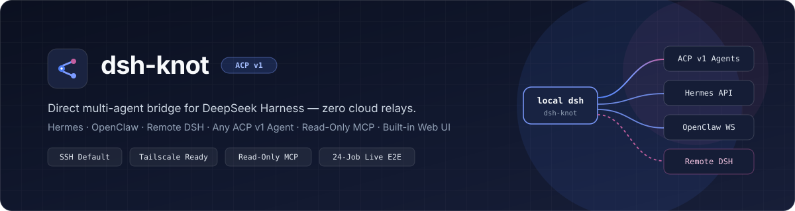
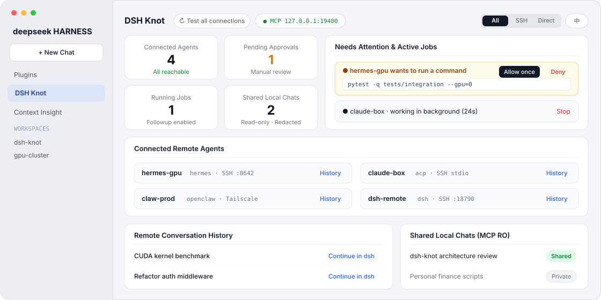
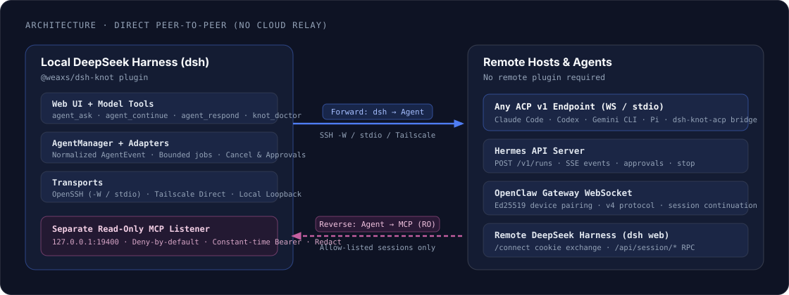

<p align="center">
  
</p>

<p align="center">
  <a href="https://github.com/Weaxs/dsh-knot/actions/workflows/ci.yml">
    
  </a>
  <a href="https://github.com/Weaxs/dsh-knot/actions/workflows/e2e.yml">
    
  </a>
  <a href="https://www.npmjs.com/package/@weaxs/dsh-knot">
    
  </a>
  = 22.13" />
  
  <a href="LICENSE">
    
  </a>
</p>

<p align="center">
  Connect <strong>DeepSeek Harness (dsh)</strong> directly with <strong>any ACP v1 agent</strong>, <strong>Hermes</strong>, <strong>OpenClaw</strong>, and remote <strong>dsh</strong> instances over <strong>SSH</strong>, <strong>Tailscale</strong>, or <strong>local</strong> transports — with a built-in dsh Web UI and read-only MCP session sharing. <strong>No cloud relay, no broker, and no remote plugin required.</strong>
</p>

---

## Highlights

| Capability                   | What you get                                                                                                                                                                                                                |
| ---------------------------- | --------------------------------------------------------------------------------------------------------------------------------------------------------------------------------------------------------------------------- |
| **Universal ACP v1**         | Connect any ACP v1 WebSocket or NDJSON stdio agent (Claude Code, Codex, Gemini CLI, Pi, Goose, etc.) locally or over SSH.                                                                                                   |
| **Native Drivers**           | First-class native adapters for **Hermes** (`/v1/runs` + SSE), **OpenClaw** (Gateway WebSocket v4 + Ed25519 pairing), and **remote dsh** (`/api/session/*` RPC), plus the optional `dsh-knot-acp` bridge.                   |
| **Built-in dsh Web UI**      | Native horizontal Bento panel inside `dsh web` for one-click approvals, background job cancellation, `knot_doctor` diagnostics, remote session browsing, and live read-only MCP sharing toggles (bilingual `zh-CN` / `en`). |
| **Zero-Config GUI Settings** | Exports a `@deepseek-ai/schemastery` Config schema so `dsh Settings → Plugins` renders a visual form automatically.                                                                                                         |
| **Read-Only MCP Export**     | Expose explicitly allow-listed local dsh sessions to remote agents on a separate loopback/tailnet port with deny-by-default access, constant-time bearer auth, and recursive secret redaction.                              |
| **Validated by Live E2E**    | 24-job real model-backed E2E matrix across Local, SSH, Tailscale, and Headscale.                                                                                                                                            |

---

## Web UI Dashboard

When loaded in `dsh web`, **dsh-knot** registers a native sidebar entry (**Remote Agents / 远端助手**) that matches DeepSeek Harness's horizontal workspace canvas without duplicating the main chat window:

<p align="center">
  
</p>

- **Approve or cancel in one click**: Remote approval prompts and active background jobs appear at the top of the panel.
- **Inspect connections**: Run `knot_doctor` across all configured agents or expand per-agent SSH and gateway checks.
- **Browse remote history**: Search and page through remote sessions, then copy a ready-to-paste `agent_continue` prompt back into your main dsh chat.
- **Control local sharing**: Toggle which local dsh sessions are visible over the separate read-only MCP listener.

---

## Architecture

<p align="center">
  
</p>

See [docs/DESIGN.md](docs/DESIGN.md) for protocol contracts, event normalization, and security boundaries.

---

## Install

Both npm package names ship identical builds: **`@weaxs/dsh-knot`** and **`dsh-knot`**.

### From npm inside DeepSeek Harness

```text
Plugins → Add plugin → npm → @weaxs/dsh-knot
```

### From a local checkout

```bash
git clone https://github.com/Weaxs/dsh-knot.git
cd dsh-knot
npm ci
npm run build
```

Then add the absolute repository directory through **Plugins → Add plugin** and restart dsh.

---

## Quick Start (Frontend UI — No Environment Variables Required)

You can configure as many agents as you need directly from the **DSH Knot Web UI** (or **`Settings → Plugins → DSH Knot`**), with each agent storing its own endpoint and token independently:

1. Open **Remote Agents / 远端助手** in the left sidebar of `dsh web`.
2. Click **`+ Add Agent` / `+ 添加助手`**.
3. Choose the protocol (**ACP v1**, **Hermes**, **OpenClaw**, or **Remote DSH**), transport (**SSH**, **Direct / Tailscale**, or **Local**), host/SSH alias, and paste that agent's token directly into the password field.
4. Click **Save** — the agent is activated immediately and persisted under `$DSH_HOME/knot/agents.json` with `0600` file permissions (tokens are never sent back to the browser).

### Alternative: Declarative `cordis.patch.yml`

If you prefer declarative configuration, add agents under `knot` in `cordis.patch.yml` (each agent can specify its own `token` or an optional `tokenEnv` fallback):

```yaml
- id: knot
  name: "@weaxs/dsh-knot"
  config:
    agents:
      - id: claude-box
        kind: acp
        transport: ssh
        ssh: dev-vm
        acpTransport: stdio
        acpCommand: /usr/local/bin/claude-code-acp
      - id: hermes-gpu-1
        kind: hermes
        transport: ssh
        ssh: gpu-box-1
        port: 8642
        token: your-first-hermes-token
      - id: hermes-gpu-2
        kind: hermes
        transport: ssh
        ssh: gpu-box-2
        port: 8642
        token: your-second-hermes-token
      - id: claw-prod
        kind: openclaw
        transport: direct
        host: claw-server
        port: 18789
        token: your-openclaw-token
      - id: dsh-remote
        kind: dsh
        transport: ssh
        ssh: dsh-box
        port: 18790
        token: your-remote-dsh-launch-token
```

> **Note:** OpenClaw creates one persistent Ed25519 device identity per agent under `$DSH_HOME/knot/devices` (mode `0600`). Approve that device once in OpenClaw. For SSH host aliases and troubleshooting, see [docs/SSH.md](docs/SSH.md).

### Verify with `knot_doctor`

Click **Test all connections** in the Web UI or ask dsh:

```text
Use knot_doctor to check every configured agent.
```

`knot_doctor` checks SSH config, non-interactive login, gateway reachability, and protocol health without modifying `~/.ssh/config` or accepting unknown host keys. On forwarding-only SSH keys without shell login, `ssh-login` reports the restriction while `gateway-health` is still verified.

---

## Model Tools

| Tool             | Purpose                                                                           |
| ---------------- | --------------------------------------------------------------------------------- |
| `agent_list`     | List configured agents and optionally probe their health.                         |
| `agent_ask`      | Start a remote task and return a `jobId` immediately (or `wait: true`).           |
| `agent_continue` | Send a follow-up message to the same remote session.                              |
| `agent_status`   | Read streamed output, state, errors, and pending approvals.                       |
| `agent_cancel`   | Abort the local stream and cancel the remote run while preserving partial output. |
| `agent_respond`  | Answer a pending remote approval using one of its offered choices.                |
| `knot_doctor`    | Diagnose transport, SSH, gateway reachability, and protocol health.               |

Long tasks run in the background with bounded in-memory output and finished-job eviction. Tool cancellations (`exec.signal`) are forwarded into network calls, waits, doctor checks, and remote cancellations. When the originating dsh Agent supports `followup`, completion updates are posted back automatically.

---

## Reverse Read-Only MCP Sharing

Expose explicitly allow-listed local dsh sessions to remote agents over a **separate read-only HTTP listener** (never mounted on the dsh Web UI):

```bash
export DSH_KNOT_TOKEN='a-long-random-token'
```

```yaml
- id: knot
  name: "@weaxs/dsh-knot"
  config:
    mcp:
      enabled: true
      host: 127.0.0.1
      port: 19400
      allowSessions:
        - your-exact-dsh-session-id
```

- **Tools exposed**: `dsh_sessions_list`, `dsh_session_read`, `dsh_session_watch` (read-only).
- **Security**: Deny-by-default (`allowSessions: []` shares nothing), refuses wildcard hosts (`0.0.0.0` / `::`), constant-time Bearer verification, 1 MB body cap (`413` on overflow), 50-item JSON-RPC batch cap, and recursive circular-safe secret redaction.

Remote client snippet (e.g., Hermes over SSH reverse forwarding `-R 19400:127.0.0.1:19400`):

```yaml
mcp_servers:
  dsh:
    url: http://127.0.0.1:19400/mcp
    headers:
      Authorization: Bearer ${env:DSH_KNOT_TOKEN}
    trust: untrusted
```

---

## Transports

| Transport         | Best for                   | Notes                                                                                                   |
| ----------------- | -------------------------- | ------------------------------------------------------------------------------------------------------- |
| `ssh` _(default)_ | Existing SSH hosts         | Invokes system OpenSSH directly (`ssh -W` / stdio) with `BatchMode=yes` and `ExitOnForwardFailure=yes`. |
| `direct`          | Tailscale, Headscale, LAN  | Uses configured `host` and `port`; set `tls: true` for HTTPS/WSS.                                       |
| `local`           | Agents on the same machine | Defaults to `127.0.0.1`.                                                                                |

---

## Development & Release

```bash
npm ci
npm run lint
npm run typecheck
npm test
npm run build
npm run check
```

- Repository rules & lessons: [AGENTS.md](AGENTS.md)
- Protocol architecture: [docs/DESIGN.md](docs/DESIGN.md)
- SSH troubleshooting: [docs/SSH.md](docs/SSH.md)
- 24-job live E2E matrix: [docs/E2E.md](docs/E2E.md)

Releases are tag-triggered via GitHub Actions: bump with `npm run release <semver>` (syncs `package.json` and `src/version.ts`), push tag `v<semver>`, and CI verifies, publishes both `@weaxs/dsh-knot` and `dsh-knot` with provenance, and creates the GitHub Release.

## License

[MIT](LICENSE)
